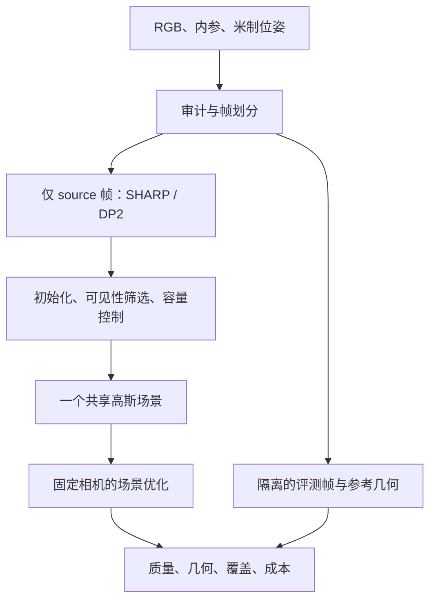

# Phase 1：已知相机的静态短视频重建

**状态：设计方案，不是实验结果。** 本文规定研究范围与决策逻辑；具体指标、运行数量和阈值以[实验协议](EXPERIMENT_PROTOCOL.md)为准，坐标与参数以[数据契约](DATA_CONTRACT.md)为准。

## 1. 第一阶段要回答的核心问题

对同一段真实静态视频，给定固定内参和米制位姿：

> 使用 SHARP 预测的形状、外观与高斯尺度作为初始化，再引入 DP2-L 深度，是否能在**独立视角质量、几何一致性、观测覆盖与计算成本**之间，形成比深度直接初始化更有价值的方案？

“把逐帧 PLY 拼起来能看到一个场景”只能证明数据通路工作，不能证明构建了稳定共享场景。必须让重复观察更新同一组可优化参数，并通过没有进入重建网络的视角评测。

我们暂时把高质量相机信息作为给定条件。这使实验可以区分深度/高斯的问题与相机估计的问题；它不意味着 ARKit、VIO 或离线 SfM 的输出是真值，也不证明将来只输入一个 MP4 就能稳定工作。

## 2. 可证伪假设

| 假设 | 对照 | 能支持的结论 | 不能支持的结论 |
| --- | --- | --- | --- |
| H1：共享优化改善直接放置的高斯 | S1 vs S0 | 同一初始化上，固定相机的多视图优化是否有效 | 所有收益来自特征匹配或新网络 |
| H2：视频深度提供有用的尺度信息 | S2 vs S1 | 每帧单标量尺度修正的实际价值 | 已解决局部形变或所有跨视图不一致 |
| H3：深度残差继续改善几何 | S3 vs S2；D1 vs D0 | 在各自初始化上，深度正则的收益与伤害 | DP2 深度是真值、质量一定单调提升 |
| H4：SHARP 初始化值得额外计算 | S2 vs D0；S3 vs D1 | 初始化策略的质量—成本权衡 | 独立证明某个 SHARP 特征模块的作用 |

每个假设都允许不成立。研究结论不得从 S0 与 S3 的大跨度差异直接归因为某一个新增模块。

## 3. 输入和适用范围

优先从 20–30 秒、固定焦距/固定曝光策略、包含平移与适度转向的静态室内视频起步。视频长度是采集建议，不是硬编码的模型限制。

第一阶段包含两个开发场景和四个锁定测试场景，覆盖：有纹理表面、弱纹理平面、薄结构/边缘、遮挡显露与回访。每个场景至少包含一段明显平移；纯原地旋转不满足此阶段的完整几何验证要求。

建议的相机信息来源按可诊断性选择：

1. 有独立标定、位姿与几何参考的小规模静态采集或许可允许的数据；
2. 同步 RGB、内参、ARKit/VIO 米制轨迹的真实采集，显式记录跟踪质量；
3. 只有视频时，先另行形成可审计的离线相机结果，再进入本协议。

来源 2/3 的轨迹如果利用了评测 RGB，结果必须标注为**给定全序列相机条件下的视角留出**。这和完全不接触测试图像的端到端系统评测不同。没有独立几何参考时，可以报告观测间一致性，不能宣布米制几何精度通过。

## 4. 最小技术方案

### 4.1 冻结模型，优化场景

SHARP 与 DP2-L 的预训练权重固定。可以离线缓存 source 帧预测；每个实验只优化共享场景的 Gaussian 参数。禁止在正式测试场景上调网络、选损失权重或选容量。

优先使用外部尺度校准与渲染深度约束，不将 SHARP 可选 `depth=` 参数直接视为已验证的推理接入方式。SHARP 仍依赖内部原始深度网络的特征；DP2 不会仅凭替换一个参数就成为它的等价骨干。有关官方代码证据见[相关工作](RELATED_WORK.md)。

### 4.2 先标量校准，后深度残差

S2 在各关键帧上，用可比较的、可见的 Z-depth 稳健估计一个正尺度。中心和协方差一起缩放，再用固定米制相机变换放入世界系。相机平移不跟着逐帧缩放；否则破坏给定轨迹的度量关系。

S3 在 S2 基础上约束渲染深度与可靠 DP2 像素的一致性。第一阶段不逐像素强行移动所有 Gaussian 中心，不把第二层遮挡/外观高斯压到同一可见表面；局部深度注入是独立的后续消融候选。

### 4.3 共享场景与新增观测

初始化阶段按固定帧顺序处理观测：已有可见表面由共同参数解释；只有能被 source 观测支持的未覆盖区域才能增加候选。候选关联失败、遮挡后方和新显露区域分别统计。此阶段是离线 batch：DP2 上下文、可见性和预算排序可以看到后续 source；按时间顺序处理候选不等于因果在线建图。

所有组使用相同形式的准入与预算策略，但输入几何来自该组自己的初始化。S0/S1 不能为了“公平融合”调用 DP2 深度，从而悄悄获得本应在 S2/S3 才引入的信息。

此阶段的准入是工程确定规则，不宣称已经解决长期表面身份。跨视图特征只用于输入质量和诊断；把特征轨迹加入损失或学习式全局表征会改变假设，需要在 P2 独立验证。

### 4.4 防止容量控制伪造成功

容量固定可以阻止文件无限增长，也可能把重复表面和区域缺失隐藏起来。因此同时保存准入前候选数、重访候选数、保留/拒绝原因、可见覆盖，并对最终同一场景分别评测早期与回访留出视角。这里不声称测量了在线遗忘；只有未来各时间前缀独立推理、准入和优化的实验才具备该含义。

S0 也采用同一可见性和预算规则但不做优化，以便和 S1 对照。无上限逐帧拼接仅可作为小样例问题演示，不能作为唯一弱基线来证明新方法优越。

## 5. 如何判断成功

第一阶段不采用“看起来更清晰”作为唯一验收。至少保留四类证据：

- **独立视角外观：** 真实留出 RGB 的 PSNR、SSIM、LPIPS；固定渲染/颜色处理，报告全图和预先固定的有效区域。
- **几何：** 有独立参考时报告绝对深度/表面距离与覆盖；没有参考时明确降级为跨视图一致性、平面厚度等诊断，DP2 自身不能充当独立真值。
- **共享程度：** 离线准入中回访区域的候选冗余、可见表面重复/厚度与早期视角质量；不能只统计最终 Gaussian 数，也不将离线 checkpoint 当作因果回访状态。
- **资源：** 冷启动总时长、可复用缓存后的增量时长、推理/融合/优化分项、峰值显存、存储与失败率。

同容量、同优化步数和同总时长回答不同问题。主比较固定容量和优化规则；同时报告端到端成本与质量曲线，避免把双模型额外计算藏到公共缓存中。

具体 go/no-go 数值是开发前登记的探索性决策线，在冻结之前允许依据开发集噪声和资源调整；调整必须记入版本，不能在看过测试结果后移动门槛。

## 6. 明确的失败路径

| 观察 | 首先检查 | 本阶段处理 |
| --- | --- | --- |
| 场景整体尺度或方向错误 | Z/range、K 分辨率、c2w/w2c、ARKit optical 转换 | 停止模型比较，修复契约后重跑 |
| source 重投影已明显不一致 | 时间同步、运动模糊、rolling shutter、相机漂移 | 修复/更换采集；不可让场景网络背负相机错误 |
| S2 改善尺度但边缘仍双层 | 局部形状、遮挡、第二层高斯语义 | 记录局部误差；测试 S3，不直接训练新网络 |
| S3 source loss 下降但独立视角退化 | 深度偏差、遮挡掩码、损失权重 | 按预注册规则判为有害，不调测试参数补救 |
| D0/D1 与 SHARP 同等或更优 | 两条路线的容量与成本是否可比 | 优先简化初始化；后续仍可研究共享关联 |
| 控制数量后地图出现孔洞 | 准入/预算丢弃、遮挡判定 | 连同覆盖和失效比例报告，不以低内存宣称成功 |

## 7. 第一阶段完成的定义

完成不是“所有实验都赢”。完成意味着：输入可信、协议冻结、对照运行或明确记录未执行原因、结果可复核，并能对 H1–H4 分别给出支持、否定或证据不足的结论。

只有完成上述判断，才应决定是否投入跨视图特征关联、全局 token、位姿联调或实时化。
