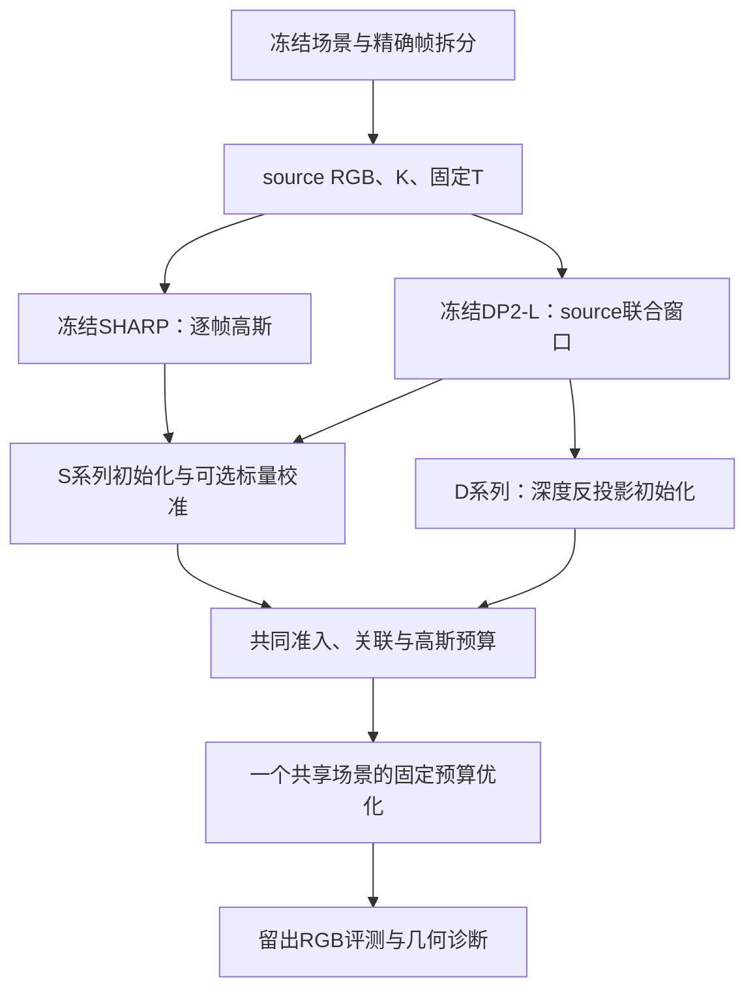

# 第一阶段技术设计

状态：**设计研究仓库；尚未下载权重、实现训练管线或运行模型。** Apple 后端是条件候选，执行条件见 [THIRD_PARTY.md](THIRD_PARTY.md)。本文的算法选项与阈值属于待验证设计，不能读作已得到的实验结论。

## 1. 第一阶段到底验证什么

给定同一组真实 source 图像、固定的度量位姿与标定，在相同初始高斯预算、公共准入规则、共享优化预算和留出视角下，验证三个可拆开的命题：

1. SHARP 的逐帧预训练高斯能否形成有用的共享场景初始化。
2. DP2-L 的跨帧深度是否通过**每帧一个标量尺度**改善跨视角几何一致性。
3. 加入可靠可见表面的 DP2 depth loss 后，是否进一步提高留出表现，而不是只让结果更像深度模型自身。

同时设置 DP2 反投影的常规高斯初始化。若该基线达到相同质量或更好的成本表现，必须承认当前条件下 SHARP 未证明额外价值。

第一阶段不同时引入位姿优化、全局特征 loss、局部 depth warp、神经网络微调、动态场景、生成图像补证据或完整多摄像头支持。这样才能定位结果来自初始化、尺度还是深度约束。

## 2. 已知事实与研究假设

| 内容 | 证据状态 | 对设计的影响 |
|---|---|---|
| SHARP逐图生成高斯，原模型使用改造的Depth Pro编码器、两层depth与高斯解码器 | 官方源码与论文事实 [S1]、[S2]、[P1] | 冻结模型，把它当初始化器 |
| SHARP内部输出约118万个高斯，带位置、尺度、旋转、颜色、alpha | 官方事实 [S2]、[P1] | 需要明确采样、去重和预算；不能每帧无限累积 |
| DP2可联合处理多帧clip，输出米制光轴深度；公开接口没有位姿条件或已校准confidence | 官方源码事实 [D1] | 使用source-only窗口和外部几何检验，不把temporal stability等同于几何真值 |
| DP2深度比SHARP本身更适合作为本数据的尺度参考 | **未验证假设** | 由S1→S2对照判断，失败时保留结论 |
| SHARP预训练的细节和外观初始化比直接depth反投影更有价值 | **未验证假设** | 由S2对D0、S3对D1判断 |
| 少量共享优化能消除重复表面和视觉冲突 | **未验证假设** | 记录留出质量、几何诊断、预算和耗时 |

SHARP的目标是输入附近视角的高质量呈现，论文明确未以大范围走动为目标。[P1] 本项目研究能否利用真实多视角证据扩展到共享场景，不把单图demo直接当完整场景重建证明。

## 3. 实验臂与执行顺序

| 臂 | 初始化 | DP2标量校准 | 共享RGB优化 | DP2 depth loss |
|---|---|---|---|---|
| S0 | SHARP，经公共准入和固定预算 | 无 | 无，仅诊断 | 无 |
| S1 | 与S0相同 | 无 | 有 | 无 |
| S2 | SHARP | 每个source帧一个 `s_i` | 有 | 无 |
| S3 | 与S2相同 | 同S2 | 有 | 有 |
| D0 | DP2可见depth反投影的标准高斯 | 不执行SHARP校准 | 有 | 无 |
| D1 | 与D0相同 | 不执行SHARP校准 | 有 | 有 |

P1a 使用2个开发场景运行 S0/S1/S2/D0，解决契约、数值、预算和可见性错误；P1b 在冻结配置后使用4个正式测试场景运行 S1/S2/S3/D0/D1。S3/D1必要的开发侧合法性检查、场景与帧拆分、实际预算和判定规则以 [EXPERIMENT_PROTOCOL.md](EXPERIMENT_PROTOCOL.md) 和冻结配置为准。

S0不是与完成优化的结果同等条件的竞争者。S1→S2测标量校准，S2→S3测SHARP初始化下的depth loss，D0→D1测常规初始化下的depth loss；S2对D0、S3对D1测SHARP初始化的额外价值。

所有需要DP2的分支记录其额外推理成本。不能只对比高斯优化秒数而忽略模型运行、准入和转换。

## 4. 最小模块边界

图中DP2到S系列的边仅适用于S2/S3；S0/S1的执行器不得加载DP2结果。留出RGB只在评测器内可读。

建议实现接口而非立即绑定某个训练框架：

| 模块 | 输入 | 输出及约束 |
|---|---|---|
| Dataset validator | immutable raw与split manifest | canonical source视图、问题报告、哈希 |
| SHARP adapter | 单个source RGB、实际K | 相机坐标物理高斯、两层provenance、源视角诊断 |
| DP2 adapter | 同一相机的source窗口、显式焦距 | 每帧Z-depth、全部context IDs、有效区 |
| Depth aggregator | 同帧多个窗口预测 | 固定log-median结果；不优化或挑选窗口 |
| Scale calibrator | SHARP可见第一层depth、DP2 depth | 每帧 `s_i`、样本数、残差及失败原因 |
| Scene initializer | per-frame候选、固定K/T | 公共预算下的唯一共享高斯集合及来源映射 |
| Shared optimizer | 一个场景、source RGB；可选DP2 depth | 固定步数/预算checkpoint与日志 |
| Evaluator | 冻结checkpoint、留出K/T及RGB | 统一渲染、指标、分区域诊断与耗时 |

接口必须执行 [DATA_CONTRACT.md](DATA_CONTRACT.md)。这里的接口是实现目标，不是仓库现成API。

## 5. 冻结模型、固定相机

SHARP与DP2权重均 `eval`、不求梯度。保存代码固定版本、实际权重SHA-256、精度、硬件、推理输入尺寸和配置。网络推理可以缓存，但缓存key必须包含完整source输入、K、窗口ID和变换哈希。

相机位姿和K在每个实验臂中完全相同，不通过RGB loss调整。没有可追溯的相机标定或米制轨迹时，先修复数据导入，不能通过“优化后看起来更好”掩盖前提不成立。

若固定轨迹由完整视频的ARKit/SfM产生，报告其曾读取留出RGB的可能性。这里评估的是给定固定轨迹的留出渲染，不同时宣称严格未见视角的相机定位能力。

## 6. SHARP adapter：保留原网络，明确真实坐标

官方 `predictor.py` 中先计算两层monodepth与特征，再进行初始化、属性残差预测和组合。[S1] 第一阶段保留这套预训练映射，不替换encoder，也不把DP2的特征张量接进原decoder。

adapter需要完成：

1. 使用采集标定，禁止EXIF缺失时默默采用默认30mm焦距。[S4]
2. 跟踪canonical图像到SHARP内部1536网格的真实图像变换。
3. 按实际K进行反投影，得到源相机坐标下的物理高斯。
4. 保留每个高斯的source帧、原始索引、层ID和内部grid来源。
5. 生成源视角的RGB、alpha，以及第一层可见depth诊断。
6. 在不做任何跨帧融合前验证单帧渲染与官方路径一致到预先定义的数值容差。

### 6.1 外部depth hook不进入第一阶段主分支

官方 `RGBGaussianPredictor.forward(image, disparity_factor, depth=None)` 的确有外部depth参数；它通过 learned alignment 估计局部尺度图，并共同缩放两层内部深度。源码说明这用于训练时对齐，推荐默认推理使用 `depth=None`。[S1]、[S5]

论文D.4的privileged-depth实验采用 `median(D_ref/D_pred)` 的**全局标量**，不能据此声称“推理时喂DP2到learned alignment”已获得验证。[P1]

所以S2仅在源相机高斯完成后施加每帧全局尺度；S3增加场景级depth residual。learned depth hook、逐像素warp和网络改造属于后续独立实验，需要新的对照与分布适配分析。

## 7. DP2-L：source-only窗口与度量标量

### 7.1 窗口推理

source关键帧按时间排序，起始窗口16、重叠4。所有帧使用同一个经矫正的相机网格和显式焦距。使用离线joint clip推理；未来若改成缓存流式推理，要单列方法配置，不能混作相同结果。

同帧重复预测按 [DATA_CONTRACT.md](DATA_CONTRACT.md) 的逐像素log-median合并。窗口不包含validation/test图像，模型输出也不利用它们的特征或depth校正。

DP2声称的temporal consistency不等于给定本项目K/T后的重投影一致性。模型不接受本项目的完整外参条件；因此保留重投影与表面厚度诊断。[D1]

### 7.2 每个source帧一个SHARP尺度

使用该source视角下**SHARP层0高斯单独渲染**得到的归一化可见Z-depth `D_sharp_i`，而不是把原始源grid索引与偏移后的高斯中心直接一一对应。渲染深度定义与alpha门槛固定，避免把两层及背景混成一个错误参考。

在有效静态图像区、两份深度均为有限正值且SHARP层0渲染有充分alpha的像素集合 `M_i` 上：

$$
\ell_i=\operatorname{median}_{u\in M_i}
\left[\log D_i^{\mathrm{DP2}}(u)-\log D_i^{\mathrm{SHARP}}(u)\right],
\quad s_i=\exp(\ell_i)
$$

这是**每帧一个标量，不是每个像素或每个DP2窗口一个自由变形**。像素有效性、最少样本、允许尺度区间、拟合前后残差和离群比例均记录。样本不足或尺度异常时进入明确失败/跳过规则；不能悄悄截断到一个看似合理的值后不报告。

将该源相机中的均值和协方差分别乘 `s_i` 与 `s_i²`，再用固定 `T_wc` 放进世界。相机平移不乘 `s_i`。本步骤不会保证局部形状正确，尺度校正后的重投影残差正是需要测量的对象。

DP2仍为模型先验。第一阶段不以test depth校准它的绝对尺度，也不把S2尺度变小本身当作质量提升。若将来引入LiDAR或source三角化度量锚点，需作为独立、所有相关臂对称开放的实验因素。

## 8. D0/D1：强制设置的简单几何基线

将DP2 source有效深度用相同K/T反投影到世界。初始颜色来自相同source RGB，初始opacity、尺度、朝向规则在开发场景固定，透明度不能按test外观调整。

第一阶段可采用确定的标准高斯初始化：例如尺度由像素投影足迹与深度决定，朝向选统一的相机基或有可靠邻域支持时的表面基。**最终只选一个规则冻结，所有D臂完全相同**，并记录其数值配置。不能给D0一个明显不足的点数或任意不合理尺度来凸显SHARP。

D0/D1经过与S臂相同的准入、预算、场景渲染器和优化器。它们无需学习第二层补全；覆盖不足作为真实结果记录。

## 9. 共享场景初始化：准入、关联、预算

### 9.1 为什么不能直接拼接所有PLY

每帧SHARP输出都试图解释该帧图像。将相同表面的多份高斯直接叠加，会改变透射率、引入重复表面和颜色冲突；即使中心接近，也不等于参数可以独立平均。官方每帧约118万高斯，使盲目累积还有明显存储与优化成本。[S2]、[P1]

第一阶段输出必须是**一个被所有source共同渲染的高斯集合**，不允许评测时按最近相机切换到某一帧的局部PLY冒充全局模型。

### 9.2 公共准入不污染SHARP-only对照

公共准入只读取source RGB/公共mask/固定K,T，以及该臂自身初始化在source视角下渲染出的表面。S0/S1不能读取DP2作为剔除、权重、排序或阈值依据。S2/S3的DP2影响通过明确的尺度步骤进入；D臂的几何本来来自DP2。

固定规则包含：

- 有限坐标、正尺度、合法alpha与四元数；超大或退化高斯单列拒绝。
- 源视角有效区和动态mask检查。
- 其他source视角中的supported、occluded、unknown和free-space conflict区分。
- 边界及薄结构单列诊断，避免用简单几何门槛把目标细节全部删掉。

初版可以对有至少一个其他source支持的高斯优先准入，同时预留固定比例给仅一个source可见、但没有可靠自由空间冲突的新区域。该规则及比例在开发场景冻结；不能把“缺少支持”与“证据反对”混为一谈。

### 9.3 关联与去重

使用世界空间局部邻域作候选检索，再检查可见深度、表面方向或协方差形状、颜色与source观察关系。空间相近只是候选，不能直接认定是同一表面；尤其要防止前后景边界、近邻货架薄板与SHARP第二层误合并。

第一阶段推荐**保留最佳代表并汇总来源**的确定性去重，避免无依据地平均opacity与四元数。排序使用冻结的source时间/ID、可见支持和源侧质量规则，不能使用留出质量。

不在第一阶段引入学习型关联网络。若现阶段无法可靠判断两份高斯是否同一表面，应保留冲突诊断或拒绝低证据候选，而不是默认做参数平均。

### 9.4 固定预算

所有方法使用同一高斯上限 `B`、公共采样规则和source覆盖策略。达到上限后按冻结排序选择，记录准入前、准入后、去重后及最终数量；记录各source和各区域的覆盖，防止预算全被一个近距离视角占据。

若某臂无法产出足够合格高斯，保留实际数量并报告不足，不能复制高斯填满。主比较需要解释实际数量差异，必要时在开发阶段把共同预算降低到可满足的范围后重新冻结。

S0与S1复用相同初始化cache，S2与S3复用相同初始化cache，D0与D1复用相同初始化cache，确保相邻对照只差规定因素。

## 10. 共同渲染与固定预算优化

### 10.1 只优化共享高斯

可训练参数为同一组高斯的均值、log scale、旋转、opacity logit和颜色参数。模型权重、K/T、DP2预测、source身份和离散关联不求梯度。

第一阶段关闭自适应densification/splitting及按分支不同的pruning，维持可解释的点数和优化预算；若数值无效高斯需要统一处理，必须记录数量与原因。未来密度控制是独立因素。

所有臂使用同一source采样次序、随机种子集合、训练分辨率、优化器、学习率、迭代次数和checkpoint选择规则。同时报告质量对步数、质量对总时间，不能只报告最有利的某一个终点。

### 10.2 公共RGB loss

在相同source图像有效静态mask上，使用冻结的重建loss：

$$
L_{\mathrm{rgb}}=
\lambda_1 L_1(\hat I,I)
+\lambda_s(1-\operatorname{SSIM}(\hat I,I))
$$

颜色空间、背景、alpha合成和mask如何作用于SSIM窗口均由共同渲染器明确定义。无效像素不能填黑后作为真实背景参与loss。该形式是研究选择，不声称等同于SHARP原训练loss。

如果需要尺度/各向异性/opacity正则，所有臂同等启用，权重在开发场景冻结。避免引入强位置先验把每种初始化锁死后，又将差异解释为可优化场景的上限。

### 10.3 S3与D1独有的depth loss

渲染器按同一front-to-back权重输出归一化期望深度：

$$
\hat D(p)=\frac{\sum_g w_g(p)z_g}{\sum_g w_g(p)+\epsilon},
\quad w_g=T_g\alpha_g
$$

只在alpha充足、DP2有效、静态且满足预先冻结的多source深度一致性检查的像素上使用：

$$
L_D=\frac{\sum_p m(p)\,q(p)\,\rho(\log\hat D(p)-\log D^{\mathrm{DP2}}(p))}
{\sum_p m(p)q(p)+\epsilon}
$$

`q` 是来源明确的启发式可靠性权重，不是DP2官方输出的已校准置信度。它只由source数据计算并detach；mask、门槛与权重规则对S3/D1一致。高斯可混合多个深度层，因此期望深度不总是实体前表面；边界、半透明和多峰区域需要排除或单独诊断，不能把depth residual压小等同于几何必然更真实。

**防止通过降低alpha逃避depth约束：** 先由teacher/source数据生成固定的 `teacher_fixed_mask` 与可靠性权重，优化中不得根据场景误差缩小这份基准区域。依赖渲染alpha的eligibility mask必须detach，另行记录它占固定teacher有效区的比例、每帧有效像素数、每步实际depth监督覆盖与alpha分布。detach只能阻断当前mask选择的直接梯度，不能消除跨步通过降低alpha逃避监督的可能，因此最低覆盖阈值、允许持续步数和失败规则也必须在dev冻结。

有效集合为空时，不能靠分母epsilon得到零loss然后宣布通过。该source样本的depth项标记为 `skipped_empty_depth_mask` 并记录原因；若整批没有有效监督，或者持续覆盖低于冻结门槛，停止并按协议记录失败/不可评估。不能在看到test结果后扩大排除mask，也不能用更低的depth residual掩盖监督像素不断减少。

优化目标为公共RGB项及共同正则，S3/D1再加 `lambda_depth*L_D`。S2不加depth loss，确保可以区分“初始化尺度改善”和“持续先验约束”。

### 10.4 梯度边界

SHARP官方 `apply_transform` 正确变换均值与协方差，但协方差分解会detach并转到CPU，源码明确为不可微操作。[S3] 本阶段将其限制在初始化：一次性转换到物理世界空间后，重新建立共享高斯可训练参数。

后续若要优化位姿、标量校准或非刚性warp，必须单独设计可微变换与测试，不能假设沿用官方helper就能向前面的网络或相机回传。

source RGB和teacher depth都作为固定观测，任何相机对、mask或关联改变应属于显式外循环，不在反传中偷偷使用不可微选择。

## 11. 全局特征在第一阶段的位置

用户提出的全局特征约束是后续方向，但第一阶段不把DINO、语义embedding或学习型匹配loss放入主目标。语义相似既不保证同一实体，也不直接提供米制位置约束，尤其重复托盘、纸箱和货架需要防止错误关联。

允许的第一阶段用途是：

- source-only的离线诊断，显示哪些区域在多视角明显不一致；
- 不参与优化或准入决策的候选对应可视化；
- 为后续“几何验证过的track约束”保存接口与所需provenance。

若将来增加feature tracks，必须先经过K/T、遮挡与几何一致性验证，再明确约束的是深度、位置、对象身份还是渲染特征。需要增加独立对照，不能与DP2尺度校正同时加入后统一宣称二者都有效。

## 12. 最低实现检查与失败诊断

| 风险 | 实现时必须回答的问题 |
|---|---|
| 坐标翻转或内参错位 | 单帧原视角是否对得上？已知点在邻帧是否落在正确位置？ |
| Z-depth与range混用 | 广角边缘是否出现有规律的拉伸？深度producer是否声明光轴定义？ |
| 每帧尺度无意义 | `s_i`样本数、残差、离群比例、尺度范围是否支持该拟合？ |
| 重复表面和opacity叠加 | 准入与去重前后表面厚度、点数及渲染alpha如何变化？ |
| SHARP第二层误当实体 | 各层留存与跨视角支持分别是多少？ |
| 深度损失自证 | 对DP2的残差降低是否同时改善真实留出RGB与独立几何诊断？ |
| 先验压制细节 | 细杆、托盘边缘等区域在S2→S3是否退化？ |
| baseline预算不公平 | D与S的实际点数、初始化、source覆盖和优化预算是否可比？ |
| 数据泄漏 | 任意模型context、匹配、校准和缓存是否引用了留出RGB？ |
| 位姿误差主导 | 不改位姿时错误是否随视角/时间系统性增长？是否超出本阶段可归因范围？ |

检查应验证数据和数学性质，不依赖“看起来不错”的截图。实验报告同时保留失败场景、无改进结果与无法区分的情况。模型没有运行前，不填写质量数字、速度提升或已经通过的测试结果。

## 13. 下一阶段的准入条件

只有第一阶段能分清SHARP初始化、DP2尺度及depth loss各自的作用，才讨论学习型特征关联、局部depth hook、位姿微调、密度控制或模型蒸馏。若主要误差来自采集标定或轨迹，应先修复输入；若D0/D1已经更合适，则保留直接深度初始化路线。

这份设计允许研究结果否定SHARP作为主初始化器，而不是让所有分支都导向预设结论。

## 固定版本的官方依据

- [S1：SHARP predictor，`aed6527499ef91cba3b54c18d49a870f25947190`](https://github.com/apple-aiml-research/ml-sharp/blob/aed6527499ef91cba3b54c18d49a870f25947190/src/sharp/models/predictor.py)。
- [S2：SHARP参数与两层设置，同一提交](https://github.com/apple-aiml-research/ml-sharp/blob/aed6527499ef91cba3b54c18d49a870f25947190/src/sharp/models/params.py)。
- [S3：SHARP高斯变换、颜色及PLY，同一提交](https://github.com/apple-aiml-research/ml-sharp/blob/aed6527499ef91cba3b54c18d49a870f25947190/src/sharp/utils/gaussians.py)。
- [S4：SHARP图像与焦距读取，同一提交](https://github.com/apple-aiml-research/ml-sharp/blob/aed6527499ef91cba3b54c18d49a870f25947190/src/sharp/utils/io.py)。
- [S5：SHARP learned alignment，同一提交](https://github.com/apple-aiml-research/ml-sharp/blob/aed6527499ef91cba3b54c18d49a870f25947190/src/sharp/models/alignment.py)。
- [D1：DP2接口，`aa389cbb0b74341664ed663a0966c859905cd6c0`](https://github.com/apple-aiml-research/ml-depth-pro-2/blob/aa389cbb0b74341664ed663a0966c859905cd6c0/src/depth_pro_2/model.py)。
- [P1：SHARP论文v2，§1、§3及D.4](https://arxiv.org/html/2512.10685v2)。

[S1]: https://github.com/apple-aiml-research/ml-sharp/blob/aed6527499ef91cba3b54c18d49a870f25947190/src/sharp/models/predictor.py
[S2]: https://github.com/apple-aiml-research/ml-sharp/blob/aed6527499ef91cba3b54c18d49a870f25947190/src/sharp/models/params.py
[S3]: https://github.com/apple-aiml-research/ml-sharp/blob/aed6527499ef91cba3b54c18d49a870f25947190/src/sharp/utils/gaussians.py
[S4]: https://github.com/apple-aiml-research/ml-sharp/blob/aed6527499ef91cba3b54c18d49a870f25947190/src/sharp/utils/io.py
[S5]: https://github.com/apple-aiml-research/ml-sharp/blob/aed6527499ef91cba3b54c18d49a870f25947190/src/sharp/models/alignment.py
[D1]: https://github.com/apple-aiml-research/ml-depth-pro-2/blob/aa389cbb0b74341664ed663a0966c859905cd6c0/src/depth_pro_2/model.py
[P1]: https://arxiv.org/html/2512.10685v2
